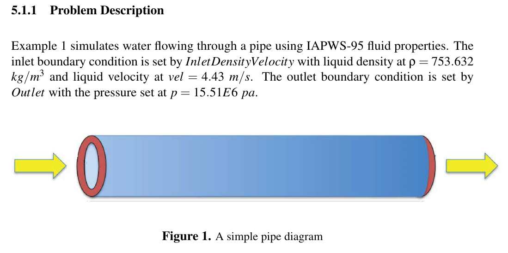
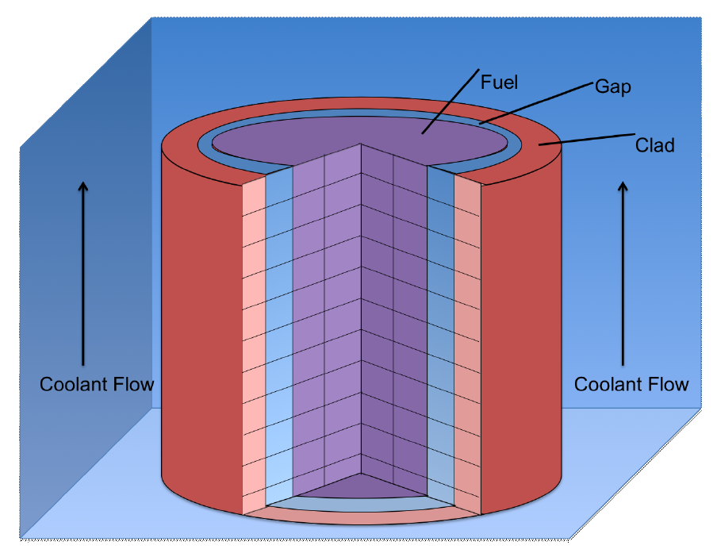
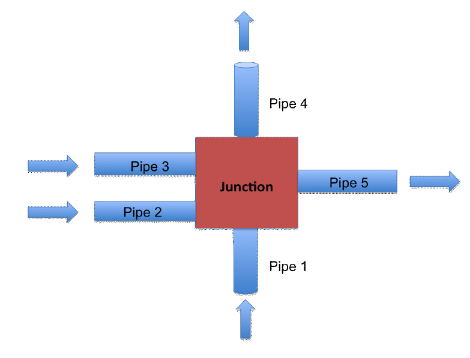
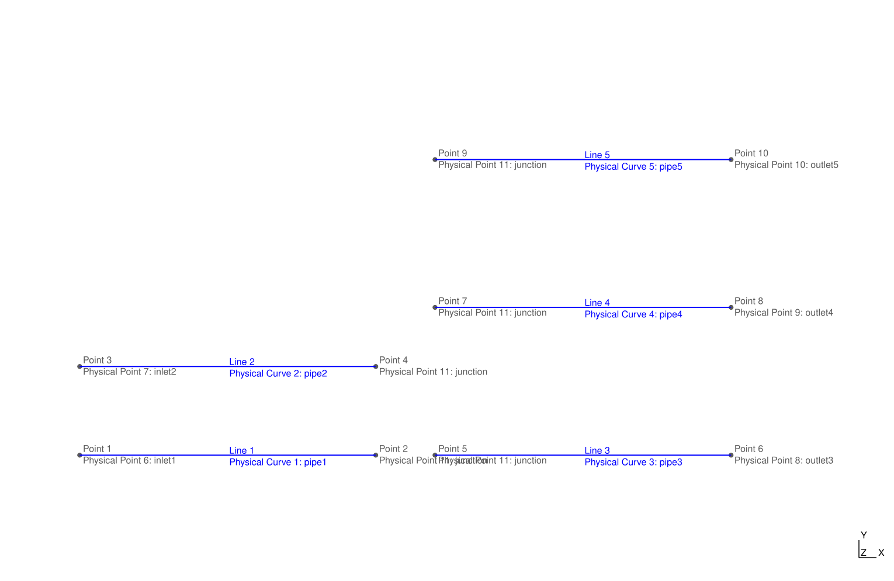
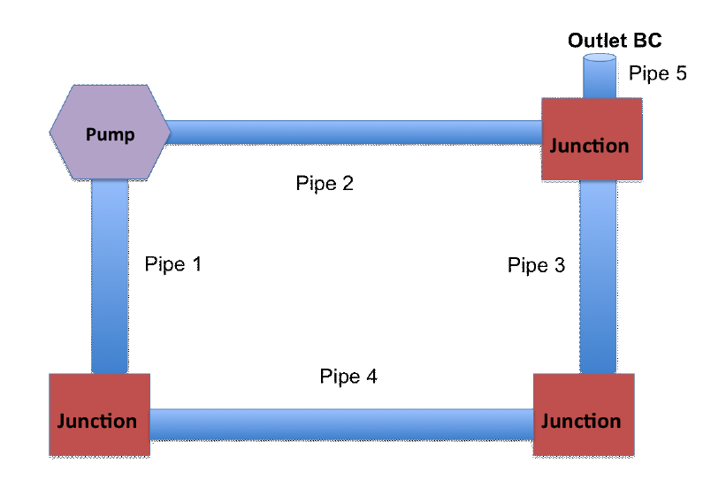
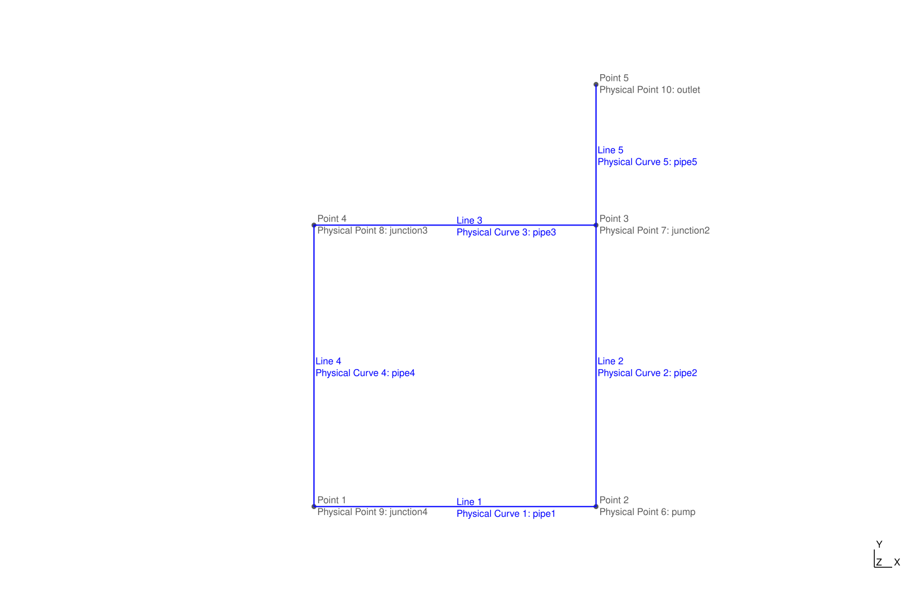
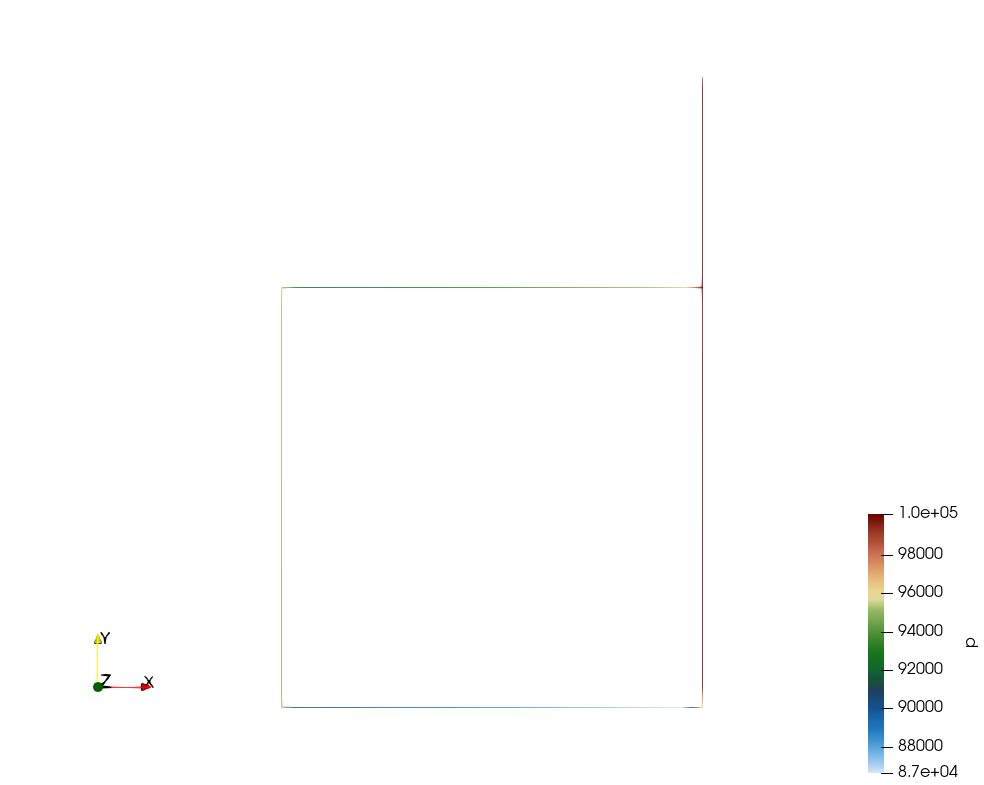
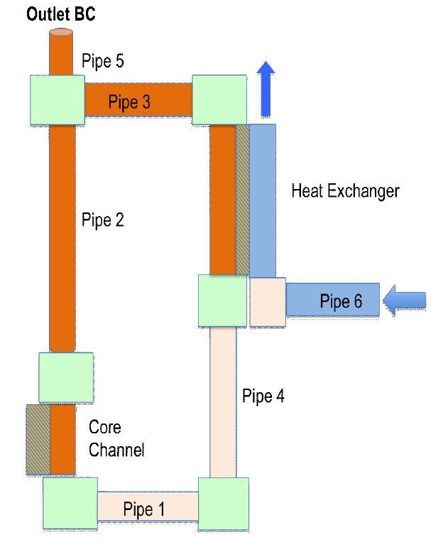
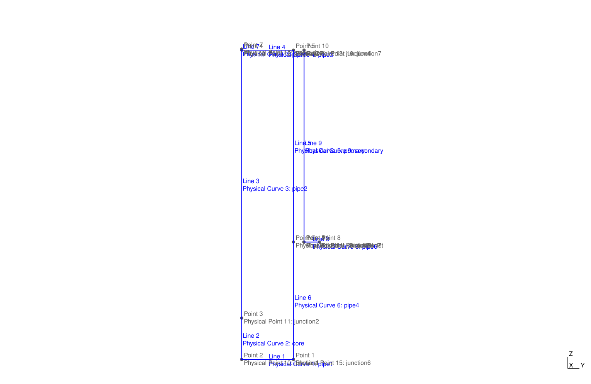
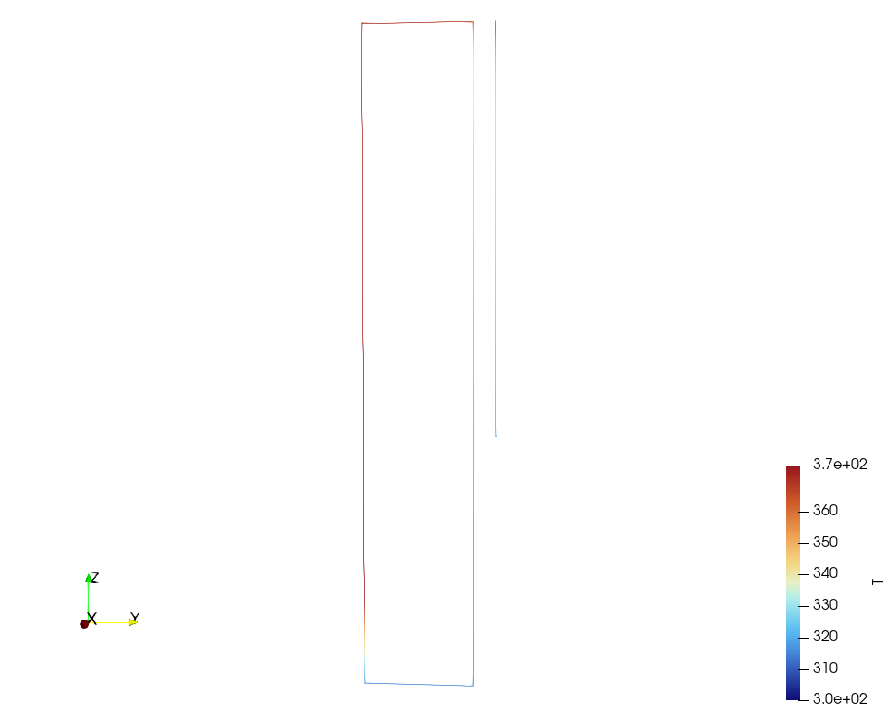

# Thermal hydraulics

- [<span class="toc-section-number">1</span> RELAP7 Example 1: A simple
  pipe flow problem]
- [<span class="toc-section-number">2</span> RELAP7 Example 2: A
  transient pipe flow problem]
- [<span class="toc-section-number">3</span> RELAP7 Example 3: Adding
  heat to a simple pipe flow problem]
- [<span class="toc-section-number">4</span> RELAP7 Example 5: A core
  channel with a fuel rod]
- [<span class="toc-section-number">5</span> RELAP7 Example 6: A
  two-pipe flow problem]
- [<span class="toc-section-number">6</span> RELAP7 Example 7: A
  junction with multiple pipes in and out]
- [<span class="toc-section-number">7</span> RELAP7 Example 8: A simple
  pipe loop with a pump]
- [<span class="toc-section-number">8</span> RELAP7 Example 9: A heat
  exchanger]
- [<span class="toc-section-number">9</span> RELAP7 Example 10: A loop
  with a core channel and a heat exchanger]

  [<span class="toc-section-number">1</span> RELAP7 Example 1: A simple pipe flow problem]:
    #relap7-example-1-a-simple-pipe-flow-problem
  [<span class="toc-section-number">2</span> RELAP7 Example 2: A transient pipe flow problem]:
    #relap7-example-2-a-transient-pipe-flow-problem
  [<span class="toc-section-number">3</span> RELAP7 Example 3: Adding heat to a simple pipe flow problem]:
    #relap7-example-3-adding-heat-to-a-simple-pipe-flow-problem
  [<span class="toc-section-number">4</span> RELAP7 Example 5: A core channel with a fuel rod]:
    #relap7-example-5-a-core-channel-with-a-fuel-rod
  [<span class="toc-section-number">5</span> RELAP7 Example 6: A two-pipe flow problem]:
    #relap7-example-6-a-two-pipe-flow-problem
  [<span class="toc-section-number">6</span> RELAP7 Example 7: A junction with multiple pipes in and out]:
    #relap7-example-7-a-junction-with-multiple-pipes-in-and-out
  [<span class="toc-section-number">7</span> RELAP7 Example 8: A simple pipe loop with a pump]:
    #relap7-example-8-a-simple-pipe-loop-with-a-pump
  [<span class="toc-section-number">8</span> RELAP7 Example 9: A heat exchanger]:
    #relap7-example-9-a-heat-exchanger
  [<span class="toc-section-number">9</span> RELAP7 Example 10: A loop with a core channel and a heat exchanger]:
    #relap7-example-10-a-loop-with-a-core-channel-and-a-heat-exchanger

# RELAP7 Example 1: A simple pipe flow problem

Let’s start with the simplest example from RELAP7 manual.

<figure>

<figcaption aria-hidden="true">Original problem description of the
problem from the RELAP7 manual. Yes, that seems to be Word and the
figure a JPG.</figcaption>
</figure>

Let us re-write the problem formulation in the proper way. Note

1.  Proper mathematical symbols (e.g. $`\text{m}`$ means “meters”, $`m`$
    means “a variable named $`m`$”)
2.  No line breaks between a value and its unit
3.  No monstrosities like 15.5E6

> Example 1 simulates water flowing through a pipe using IAPWS-97 fluid
> properties. The inlet boundary condition is set with a density at
> $`\rho = 753.632~\text{kg} / \text{m}^{-3}`$ and a velocity
> $`v = 4.43~\text{m}/\text{s}`$. The outlet boundary condition is set
> at a pressure of $`p=15.51 \times 10^6~\text{Pa}`$.

In RELAP, the topology of the piping system is given in the input file
by defining the start and end coordinates of **every single pipe**. In
FeenoX, the topology is given by a Gmsh file. So that is what we do
first:

``` c
// RELAP-7 example 1: simple horizontal pipe, L = 2 m, 5 elements
Point(1) = {0, 0, 0};
Point(2) = {2, 0, 0};
Line(1) = {1, 2};
Transfinite Curve{1} = 5+1;

Physical Point("inlet") = {1};
Physical Point("outlet") = {2};
Physical Curve("pipe") = {1};
```

Once we have the pipe as a 1D entity named `pipe` and its inlet and
outlet as 0D entities named `inlet` and `outlet`, we can then create a
simple and almost self-describing English-like LLM-friendly input file
for FeenoX.

> **Note \#1** FeenoX uses IAPWS-97 properties, not IAPWS-95.

> **Note \#2** Please understand the difference between the input file
> for FeenoX and the input file for good old RELAP (both versions 5 &
> 7).

``` feenox
# RELAP-7 manual example 1: water flowing through a 2 m long horizontal pipe
# inlet:  rho = 753.632 kg/m^3 and v = 4.43 m/s
# outlet: p = 15.51 MPa
PROBLEM thermal_hydraulics MESH relap7-pipe.msh DIM 1

MATERIAL pipe A=8.78882e-5 D_h=0.01179

BC inlet  rho=753.632 v=4.43
BC outlet p=15.51e6

SOLVE_PROBLEM

# the mass flow should be rho*v*A and the pressure drop should match an
# independent evaluation of Darcy-Weisbach with IAPWS properties and Churchill
mdot_ref = 753.632*4.43*8.78882e-5
dp_ref = 16967.2
PRINTF "\# mass conservation check %g" abs(mdot(1)/mdot_ref-1)+abs((p(0)-p(2))/dp_ref-1)

WRITE_RESULTS      # write a VTU file with all the results
PRINT_FUNCTION p   # write the pressure distribution
```

``` terminal
$ gmsh -1 relap7-pipe.geo
$ feenox relap-example1-pipe.fee 
# mass conservation check 2.86609e-05
0       1.5527e+07
2       1.551e+07
0.4     1.55236e+07
0.8     1.55202e+07
1.2     1.55168e+07
1.6     1.55134e+07
$ 
```

# RELAP7 Example 2: A transient pipe flow problem

The second example from the RELAP7 manual uses the same pipe as [example
1], but now

1.  the problem is a transient from $`t=0`$ to $`t=10~\text{s}`$, with a
    varaible time-stepping scheme starting from
    $`\Delta t_0 = 1~\text{ms}`$ using a second-order BDF method (the
    original RELAP example uses fixed $`\Delta t`$),
2.  the water starts at rest with $`p=15.51~\text{MPa}`$ and
    $`T=559.15~\text{K}`$ everywhere, and
3.  the Darcy friction factor is not computed from a correlation but
    given as a function of time that rises linearly from $`f=0.01`$ at
    $`t=0`$ to $`f=0.02`$ at $`t=50~\text{ms}`$ and stays constant
    afterwards.

The inlet still imposes $`\rho = 753.632~\text{kg}/\text{m}^3`$ and
$`v = 4.43~\text{m}/\text{s}`$, and the outlet still imposes
$`p=15.51~\text{MPa}`$. We re-use the same mesh `relap7-pipe.msh` from
example 1.

In FeenoX, a transient problem is just a problem with a positive
`end_time`. The initial conditions are given as functions `p_0`, `T_0`
and `v_0` of the space, and the time-dependent friction factor is a
regular point-wise defined function of time $`t`$ that is used in the
`f` property of the pipe material.

At the end of the transient, the mass flow should be $`\rho v A`$ and
the pressure drop should follow Darcy-Weisbach with $`f=0.02`$.

``` feenox
# RELAP-7 manual example 2: transient flow through the same 2 m long pipe
# as example 1 but with a time-dependent Darcy friction factor
# initial state: p = 15.51 MPa, T = 559.15 K and v = 0 everywhere
# inlet:  rho = 753.632 kg/m^3 and v = 4.43 m/s
# outlet: p = 15.51 MPa
PROBLEM thermal_hydraulics MESH relap7-pipe.msh DIM 1 TRANSIENT_SOLVER bdf

end_time = 10    # integrate up to t = 10 s

# to set a fixed dt just set dt
# dt = 0.01

# otherwise let feenox choose
dt_0 = 1e-3      # initial dt
min_dt = 1e-3    # min dt
max_dt = 5       # max dt

# initial conditions
p_0(x) = 15.51e6
T_0(x) = 559.15
v_0(x) = 0

# the friction factor rises linearly from 0.01 to 0.02 in the first 50 ms
FUNCTION friction(t) INTERPOLATION linear DATA {
0     0.01
0.05  0.02
0.1   0.02
}

MATERIAL pipe A=8.78882e-5 D_h=0.01179 f=friction(t)

BC inlet  rho=753.632 v=4.43
BC outlet p=15.51e6

SOLVE_PROBLEM

# write the evolution of the pressure drop, mass flow and outlet temperature
PRINT t %+.4e p(0)-p(2) mdot(1) T(2) %g friction(t)
WRITE_RESULTS   # since this is a transient, write both a single pvd and a vtu for each step

# at the end, the flow should be steady with mdot = rho*v*A and the pressure
# drop should be given by Darcy-Weisbach with the final f = 0.02
IF done
  mdot_ref = 753.632*4.43*8.78882e-5
  dp_ref = 0.02 * 2/0.01179 * mdot_ref^2/(2*rho(1)*8.78882e-5^2)
  PRINTF "\# steady-state check %g" abs(mdot(1)/mdot_ref-1)+abs((p(0)-p(2))/dp_ref-1)
  PRINT_FUNCTION p FILE $0-pressure.dat
ENDIF
```

``` terminal
$ gmsh -1 relap7-pipe.geo
$ feenox relap-example2-transient.fee
0       +0.0000e+00     +0.0000e+00     +5.5915e+02     0.01
0.001   +3.9914e+06     +1.3394e-01     +5.5915e+02     0.0102
0.003   +2.4446e+06     +4.2500e-01     +5.5916e+02     0.0106
0.007   -1.6413e+06     +4.4023e-01     +5.5916e+02     0.0114
0.011   -1.5399e+06     +2.5334e-01     +5.5916e+02     0.0122
0.019   +6.8515e+05     +2.5802e-01     +5.5916e+02     0.0138
0.035   +1.3698e+05     +3.1128e-01     +5.5916e+02     0.017
0.067   -4.3180e+04     +2.9243e-01     +5.5916e+02     0.02
0.131   +3.3648e+04     +2.9301e-01     +5.5916e+02     0.02
0.259   +2.5104e+04     +2.9348e-01     +5.5916e+02     0.02
0.515   +2.5028e+04     +2.9342e-01     +5.5917e+02     0.02
1.027   +2.5094e+04     +2.9342e-01     +5.5917e+02     0.02
2.051   +2.5090e+04     +2.9342e-01     +5.5916e+02     0.02
4.099   +2.5090e+04     +2.9342e-01     +5.5916e+02     0.02
8.195   +2.5090e+04     +2.9342e-01     +5.5916e+02     0.02
10      +2.5090e+04     +2.9342e-01     +5.5916e+02     0.02
# steady-state check 2.71691e-05
$ cat relap-example2-transient-pressure.dat 
0       1.55351e+07
2       1.551e+07
0.4     1.55301e+07
0.8     1.55251e+07
1.2     1.552e+07
1.6     1.5515e+07
$
```

  [example 1]: #relap7-example-1-a-simple-pipe-flow-problem

# RELAP7 Example 3: Adding heat to a simple pipe flow problem

The third example from the RELAP7 manual is the same transient as
[example 2] but now the pipe wall is kept at a fixed temperature
$`T_\text{wall} = 565~\text{K}`$, which is higher than the incoming
water at $`559.15~\text{K}`$. As in example 2, we use a variable time
step starting from $`\Delta t_0 = 1~\text{ms}`$ with a second-order BDF
method (the original RELAP example uses a fixed
$`\Delta t = 10~\text{ms}`$).

In FeenoX, the main change with respect to example 2 is adding
`T_wall=565` to the pipe `MATERIAL`. This adds a heat flux
$`h_\text{wall} P_h (T_\text{wall}-T)`$ per unit length to the energy
equation, where

- $`P_h`$ is the heated perimeter, and
- the heat transfer coefficient $`h_\text{wall}`$ follows the TRACE
  single-phase tube model, namely the maximum of laminar
  ($`\text{Nu}=4.36`$), corrected Gnielinski and natural convection,
  with the water conductivity from IAPWS-2011.

Both can be given with the `P_h` and `h_wall` material properties.
FeenoX’s default heated perimeter is $`4A/D_h`$, but RELAP-7 assumes the
circumference $`2\sqrt{\pi A}`$ of a circle with area $`A`$. Since here
$`A`$ and $`D_h`$ are not consistent with a circular pipe, these two
differ by about 11%, so we set `P_h=2*sqrt(pi*A)` explicitly to match
the original RELAP-7 input.

RELAP-7’s input also sets `gravity = '0 0 0'`. The pipe is horizontal so
gravity does not enter the momentum equation, but it does enter the
natural-convection part of the heat transfer coefficient. FeenoX’s
default is $`g_z = -9.81~\text{m}/\text{s}^2`$, so we set `g_z = 0` to
stay faithful to the original problem (it does not make any difference
in this case, though).

The output shows the mass flow, the temperature at the inlet and outlet
nodes and the power $`\dot{m}(h_\text{out}-h_\text{in})`$ absorbed
between those two nodes. Note that the inlet node is a control volume
that already receives half the wall heat of the first element, so its
temperature is higher than the $`559.15~\text{K}`$ of the incoming
stream. After the startup transient, the outlet temperature slightly
overshoots and then settles at $`T_\text{out} \approx 563.27~\text{K}`$.

``` feenox
# RELAP-7 manual example 3: same as example 2 but now the pipe wall
# is kept at a fixed temperature T_wall = 565 K so the water heats up
# initial state: p = 15.51 MPa, T = 559.15 K and v = 0 everywhere
# inlet:  rho = 753.632 kg/m^3 and v = 4.43 m/s
# outlet: p = 15.51 MPa
PROBLEM thermal_hydraulics MESH relap7-pipe.msh DIM 1 TRANSIENT_SOLVER bdf

g_z = 0          # RELAP's input sets gravity = '0 0 0' (FeenoX's default is g_z = -9.81)

end_time = 10    # integrate up to t = 10 s
dt_0 = 1e-3      # initial dt
min_dt = 1e-3    # min dt
max_dt = 5       # max dt

# initial conditions
p_0(x) = 15.51e6
T_0(x) = 559.15
v_0(x) = 0

# the friction factor rises linearly from 0.01 to 0.02 in the first 50 ms
FUNCTION friction(t) INTERPOLATION linear DATA {
0     0.01
0.05  0.02
0.1   0.02
}

# the main difference with example 2 is the wall temperature
# the heat transfer coefficient is computed with the TRACE single-phase
# tube correlations (laminar, Gnielinski and natural convection)
# RELAP-7 takes the heated perimeter as the circumference of a circle with
# area A, while FeenoX's default would be 4A/D_h, so we give it explicitly
A_pipe = 8.78882e-5
MATERIAL pipe A=A_pipe D_h=0.01179 f=friction(t) T_wall=565 P_h=2*sqrt(pi*A_pipe)

BC inlet  rho=753.632 v=4.43
BC outlet p=15.51e6

SOLVE_PROBLEM

# write the evolution of the mass flow, the inlet & outlet temperatures
# and the power absorbed by the water between the inlet and the outlet nodes
# note that T(0) is the temperature of the inlet control volume, which already
# receives half of the first element's wall heat, so it is not the 559.15 K
# of the stream that enters through the inlet with rho = 753.632 kg/m^3
PRINT t %.4e mdot(1) T(0) T(2) mdot(1)*(h(2)-h(0))
WRITE_RESULTS

# at the end, write the axial temperature and enthalpy profiles
IF done
  PRINT_FUNCTION T h FILE $0-profile.dat
ENDIF
```

``` terminal
$ gmsh -1 relap7-pipe.geo
$ feenox relap-example3-heat.fee
0   0.0000e+00  5.5915e+02  5.5915e+02  0.0000e+00
0.001   1.3445e-01  5.6057e+02  5.5915e+02  -7.4690e+02
0.002   3.1643e-01  5.6041e+02  5.5917e+02  -1.5567e+03
0.004   4.9060e-01  5.5965e+02  5.5923e+02  -8.6122e+02
0.006   4.2600e-01  5.5869e+02  5.5927e+02  8.9903e+02
0.01    2.0613e-01  5.5879e+02  5.5933e+02  4.2017e+02
0.018   2.6066e-01  5.5981e+02  5.5945e+02  -3.4977e+02
0.034   3.1912e-01  5.5961e+02  5.5972e+02  1.9061e+02
0.05    2.9385e-01  5.5966e+02  5.5997e+02  4.6958e+02
0.082   2.9411e-01  5.5980e+02  5.6044e+02  9.7355e+02
0.146   2.9442e-01  5.5987e+02  5.6124e+02  2.0942e+03
0.274   2.9353e-01  5.5989e+02  5.6238e+02  3.8149e+03
0.53    2.9324e-01  5.5987e+02  5.6339e+02  5.3856e+03
1.042   2.9332e-01  5.5986e+02  5.6360e+02  5.7139e+03
2.066   2.9342e-01  5.5986e+02  5.6334e+02  5.3203e+03
4.114   2.9343e-01  5.5986e+02  5.6325e+02  5.1832e+03
8.21    2.9342e-01  5.5987e+02  5.6326e+02  5.2037e+03
10  2.9342e-01  5.5987e+02  5.6327e+02  5.2093e+03
$ cat relap-example3-heat-profile.dat
0   559.865 1.26703e+06
2   563.268 1.28478e+06
0.4 560.963 1.27273e+06
0.8 561.825 1.27722e+06
1.2 562.502 1.28076e+06
1.6 563.034 1.28355e+06
$
```

  [example 2]: #relap7-example-2-a-transient-pipe-flow-problem

# RELAP7 Example 5: A core channel with a fuel rod

The fifth example from the RELAP7 manual simulates the flow of water
through a vertical PWR subchannel heated by a single fuel rod.

<figure>

<figcaption aria-hidden="true">Schematic view of the core channel
(figure 4 of the RELAP7 manual).</figcaption>
</figure>

This example simulates fluid flow and heat transfer in a core channel.
It simulates the fluid flow in one subchannel with a single fuel rod as
the heat source. A prescribed power of $`77.3~\text{kW}`$ is supplied to
the fuel rod. The inlet boundary condition sets a density
$`\rho = 753.68~\text{kg}/\text{m}^3`$ and a velocity
$`v = 4.43~\text{m}/\text{s}`$. The outlet boundary condition sets a
pressure $`p = 15.5~\text{MPa}`$. The fuel rod is made of fuel, gap and
clad, each of them with a different thermal conductivity, density and
specific heat. The vertical channel is $`3.865~\text{m}`$ long, divided
into 40 elements:

``` c
// RELAP-7 example 5: vertical core channel, L = 3.865 m, 40 elements
Point(1) = {0, 0, 0};
Point(2) = {0, 0, 3.865};
Line(1) = {1, 2};
Transfinite Curve{1} = 40+1;

Physical Point("inlet") = {1};
Physical Point("outlet") = {2};
Physical Curve("channel") = {1};
```

The RELAP7 manual says that the flow area and the hydraulic diameter of
the subchannel “can easily be calculated using a script in RELAP-7” that
has to be run from the scripts folder, giving the outer radius
$`r_o = 4.748~\text{mm}`$ of the rod and the pitch
$`p = 12.6~\text{mm}`$ of the lattice. In FeenoX there is no need for an
external script, we just write the expressions in the input file:

``` math
A = p^2 - \pi r_o^2 \qquad\qquad D_h = \frac{4A}{2\pi r_o}
```

which give the very same $`A=8.79375 \times 10^{-5}~\text{m}^2`$ and
$`D_h = 0.01179~\text{m}`$ as the manual.

The fuel rod is a `HEAT_STRUCTURE` attached to the physical group
`channel`, whose `FUEL`, `GAP` and `CLAD` layers are three other
materials with constant conductivity `k`, density `rho_s` and specific
heat `cp`. The geometry of the rod (radius and widths of each layer and
number of radial cells) and its total power `hs_power` go in the
channel’s `MATERIAL`, alongside the flow properties. The mapping with
RELAP7’s `CoreChannel` component is:

- `dim_hs = 2` is FeenoX’s default `AXIAL_CONDUCTION` (i.e. radial and
  axial conduction in the rod),
- `power_fraction = '1.0 0.0 0.0'` is FeenoX’s only option: the power is
  uniformly generated in the fuel (because the expression is a constant,
  we can have expressions of $`x`$, $`y`$, $`z`$ and/or $`t`$),
- `Hw = 5.33e4` is the heat transfer coefficient `h_wall` between the
  clad and the coolant,
- `initial_Ts = 559.15` is the initial solid temperature
  `T_solid_0(r,x,y,z)`, which is a function of the radius and the space,
  and
- the heated perimeter is the outer clad circumference in both codes.

As the RELAP7 input does not touch the gravity and the channel goes
upwards along $`z`$, we keep FeenoX’s default
$`g_z = -9.81~\text{m}/\text{s}^2`$, which is also RELAP7’s default. As
in the previous examples, the water starts at rest and we use a variable
time step starting from $`\Delta t_0 = 1~\text{ms}`$ with a second-order
BDF method (the original RELAP example uses a fixed
$`\Delta t = 100~\text{ms}`$) up to $`t=50~\text{s}`$.

The output shows the mass flow, the coolant temperature at the outlet,
the fuel centerline and clad surface temperatures at the outlet height,
and the heat transferred from the rod to the coolant, which approaches
the generated $`77.34~\text{kW}`$ as the rod reaches steady state. At
the end, the axial profiles of the coolant, clad surface, fuel surface
and fuel centerline temperatures are written into a file.

``` feenox
# RELAP-7 manual example 5: a vertical PWR core subchannel with a single
# fuel rod (fuel + gap + clad) that generates 77.3 kW
# initial state: p = 15.5 MPa, T = 559.15 K and v = 0 everywhere
# inlet:  rho = 753.68 kg/m^3 and v = 4.43 m/s
# outlet: p = 15.5 MPa
PROBLEM thermal_hydraulics MESH relap7-core-channel.msh TRANSIENT_SOLVER bdf

# the channel goes along z, which points upwards so we keep
# the default gravity g_z = -9.81 (RELAP-7's input does not change it either)

end_time = 50    # integrate up to t = 50 s
dt_0 = 1e-3      # initial dt
min_dt = 1e-3    # min dt
max_dt = 5       # max dt

# initial conditions for the fluid and for the solid
p_0(x,y,z) = 155e5
T_0(x,y,z) = 559.15
v_0(x,y,z) = 0
T_solid_0(r,x,y,z) = 559.15

# a cylindrical fuel rod with gap and clad coupled to the channel
# with radial and axial conduction (i.e. RELAP-7's dim_hs = 2)
HEAT_STRUCTURE PIPE channel FUEL fuel GAP gap CLAD clad

# properties of the solid materials
MATERIAL fuel k=2.5  rho_s=1.032e4 cp=300
MATERIAL gap  k=0.6  rho_s=1       cp=1
MATERIAL clad k=21.5 rho_s=6.55e3  cp=350

# no need for an external script to compute the flow area and the hydraulic
# diameter of a square-lattice subchannel around a rod of outer radius r_o
pitch = 0.0126                     # lattice pitch
r_o = 0.004096 + 0.0001 + 0.000552 # fuel radius + gap width + clad width
A_channel = pitch^2 - pi*r_o^2     # flow area
D_h_channel = 4*A_channel/(2*pi*r_o)   # hydraulic diameter = 4 * area / wetted perimeter

# the channel has the flow geometry, a fixed friction factor, a fixed
# heat transfer coefficient, the rod geometry and the total power,
# which is uniformly distributed in the fuel
MATERIAL channel {
  A=A_channel D_h=D_h_channel f=0.01 h_wall=5.33e4
  fuel_radius=0.004096 gap_width=0.0001 clad_width=0.000552
  fuel_cells=10 gap_cells=1 clad_cells=2
  hs_power=77337.69407
}

BC inlet  rho=753.68 v=4.43
BC outlet p=155e5

SOLVE_PROBLEM

# write the evolution of the mass flow, the coolant outlet temperature,
# the fuel centerline and the clad surface temperatures at the outlet
# and the power transferred from the rod to the coolant
PRINT t %.4e mdot(0,0,3.865) T(0,0,3.865) T_fuel_center(0,0,3.865) T_clad_surface(0,0,3.865) hs_heat
WRITE_RESULTS

# at the end, write the axial profiles of the coolant, clad surface,
# fuel surface and fuel centerline temperatures
IF done
  PRINT_FUNCTION T T_clad_surface T_fuel_surface T_fuel_center MIN 0 0 0 MAX 0 0 3.865 NSTEPS 1 1 10 FILE $0-profile.dat
ENDIF
```

``` terminal
$ gmsh -1 relap7-core-channel.geo
$ feenox relap-example5-core-channel.fee
0   0.0000e+00  5.5915e+02  5.5915e+02  5.5915e+02  0.0000e+00
0.001   7.9759e-04  5.5915e+02  5.5927e+02  5.5915e+02  -1.8439e+03
0.003   1.0765e-01  5.5915e+02  5.5952e+02  5.5915e+02  -4.2194e+03
0.005   3.7688e-01  5.5916e+02  5.5976e+02  5.5915e+02  -3.7961e+03
0.009   6.3767e-01  5.5916e+02  5.6025e+02  5.5916e+02  1.2910e+03
0.017   2.8017e-01  5.5916e+02  5.6123e+02  5.5918e+02  3.3899e+03
0.025   1.5341e-01  5.5915e+02  5.6222e+02  5.5921e+02  -2.0228e+01
0.041   3.2322e-01  5.5917e+02  5.6418e+02  5.5930e+02  8.0814e+01
0.073   3.1149e-01  5.5920e+02  5.6810e+02  5.5952e+02  2.2503e+03
0.137   2.9034e-01  5.5935e+02  5.7595e+02  5.6003e+02  4.1636e+03
0.265   2.9703e-01  5.5991e+02  5.9164e+02  5.6117e+02  7.7829e+03
0.521   2.9791e-01  5.6184e+02  6.2303e+02  5.6393e+02  1.3290e+04
1.033   2.9795e-01  5.6730e+02  6.8547e+02  5.7061e+02  2.1703e+04
2.057   2.9633e-01  5.7750e+02  8.0502e+02  5.8274e+02  3.4215e+04
4.105   2.9473e-01  5.8923e+02  1.0041e+03  5.9719e+02  5.0566e+04
8.201   2.9399e-01  5.9941e+02  1.2497e+03  6.1029e+02  6.7736e+04
12.297  2.9373e-01  6.0319e+02  1.3596e+03  6.1527e+02  7.4745e+04
17.297  2.9360e-01  6.0472e+02  1.4063e+03  6.1732e+02  7.7623e+04
22.297  2.9357e-01  6.0496e+02  1.4149e+03  6.1766e+02  7.8086e+04
27.297  2.9358e-01  6.0485e+02  1.4125e+03  6.1752e+02  7.7872e+04
32.297  2.9359e-01  6.0471e+02  1.4090e+03  6.1734e+02  7.7610e+04
37.297  2.9360e-01  6.0462e+02  1.4066e+03  6.1722e+02  7.7446e+04
42.297  2.9360e-01  6.0458e+02  1.4055e+03  6.1717e+02  7.7369e+04
47.297  2.9361e-01  6.0456e+02  1.4050e+03  6.1715e+02  7.7341e+04
50  2.9361e-01  6.0456e+02  1.4049e+03  6.1714e+02  7.7337e+04
$ cat relap-example5-core-channel-profile.dat
0   0   0   559.793 572.377 718.695 1360.13
0   0   0.3865  564.832 577.416 723.735 1365.17
0   0   0.773   569.778 582.362 728.681 1370.12
0   0   1.1595  574.624 587.208 733.528 1374.97
0   0   1.546   579.363 591.947 738.268 1379.72
0   0   1.9325  583.987 596.571 742.892 1384.35
0   0   2.319   588.487 601.071 747.393 1388.85
0   0   2.7055  592.853 605.437 751.76  1393.23
0   0   3.092   597.075 609.66  755.983 1397.45
0   0   3.4785  601.141 613.726 760.05  1401.52
0   0   3.865   604.56  617.144 763.469 1404.95
$
```

# RELAP7 Example 6: A two-pipe flow problem

This example demonstrates flow through two pipes with different flow
areas connected by a junction. The inlet boundary condition sets a
density $`\rho = 995~\text{kg}/\text{m}^3`$ and a velocity
$`v = 1~\text{m}/\text{s}`$. The outlet boundary condition sets a
pressure $`p = 95~\text{kPa}`$. The initial velocity, pressure and
temperature are $`1~\text{m}/\text{s}`$, $`100~\text{kPa}`$ and
$`300~\text{K}`$ respectively. There is no heat exchange through the
pipe walls.

The first pipe goes from $`x=0`$ to $`x=1~\text{m}`$ and has a flow area
$`A=2~\text{m}^2`$. The second one goes from $`x=1~\text{m}`$ to
$`x=2~\text{m}`$ and has $`A=1~\text{m}^2`$. Both have 20 elements and a
Darcy friction factor $`f=1`$. As in RELAP7, when the hydraulic diameter
is not given FeenoX uses the one of a circle with area $`A`$,
i.e. $`D_h = \sqrt{4A/\pi}`$.

In RELAP7, the topology is given by the position and orientation of each
pipe plus a `Junction` component that lists which pipe ends it connects.
In FeenoX, the two pipes are just two physical curves that share a node,
which we name `junction`:

``` c
// RELAP-7 example 6: two horizontal pipes of 1 m each, 20 elements each,
// with different flow areas connected by a junction at x = 1 m
Point(1) = {0, 0, 0};
Point(2) = {1, 0, 0};
Point(3) = {2, 0, 0};
Line(1) = {1, 2};
Line(2) = {2, 3};
Transfinite Curve{1,2} = 20+1;

Physical Point("inlet") = {1};
Physical Point("junction") = {2};
Physical Point("outlet") = {3};
Physical Curve("pipe1") = {1};
Physical Curve("pipe2") = {2};
```

RELAP7’s junction has `K = '1 1'` and `A_ref = 1.0`, i.e. a local loss
coefficient equal to one for each of the two ports, both referred to an
area of $`1~\text{m}^2`$. In FeenoX this is

``` feenox
JUNCTION POINT junction K_pipe1=1 K_pipe2=1 A_ref=1
```

where `K_<pipe_group>` sets the coefficient of each port by the name of
the pipe that is connected to it. Since here both are equal, `K=1` would
also work.

The initial condition from the manual has a uniform velocity of
$`1~\text{m}/\text{s}`$, which does not conserve mass because the second
pipe has half the area of the first. So the first time step has to
accommodate a pressure wave. Instead of the second-order BDF scheme of
the original RELAP example, here we use FeenoX’s default backward Euler
scheme, which dissipates the pressure waves, and let it choose the time
step up to $`t=10~\text{s}`$.

At steady state, the mass flow is
$`\dot{m} = \rho v A = 1990~\text{kg}/\text{s}`$ in both pipes, the
velocity is $`1~\text{m}/\text{s}`$ in the first pipe and
$`2~\text{m}/\text{s}`$ in the second one, and the pressure has a step
at the junction that accounts for both the local losses and the change
in kinetic energy. The output shows the mass flow in each pipe, the
inlet pressure and the pressure drop between the two nodes next to the
junction. At the end, the axial pressure and velocity profiles are
written into a file.

``` feenox
# RELAP-7 manual example 6: two horizontal pipes with different flow areas
# (A = 2 m^2 and A = 1 m^2) connected by a junction with local losses
# initial state: p = 100 kPa, T = 300 K and v = 1 m/s everywhere
# inlet:  rho = 995 kg/m^3 and v = 1 m/s
# outlet: p = 95 kPa
PROBLEM thermal_hydraulics MESH relap7-two-pipes.msh DIM 1

# integrate up to t = 10 s with the default backward Euler scheme,
# letting FeenoX choose the time step
end_time = 10

# initial conditions, the same as RELAP-7's
# note that a uniform velocity does not conserve mass because pipe2 has half the
# area of pipe1, so the first time step has to accommodate a pressure wave
# which is damped by the dissipative backward Euler scheme
p_0(x) = 1e5
T_0(x) = 300
v_0(x) = 1

# each pipe has its own flow area and the same friction factor
# the hydraulic diameter is not given so it is sqrt(4A/pi) as in RELAP-7
MATERIAL pipe1 A=2 f=1
MATERIAL pipe2 A=1 f=1

# RELAP-7's K = '1 1' means a loss coefficient equal to one for each port
# of the junction, all of them referred to the area A_ref = 1 m^2
JUNCTION POINT junction K_pipe1=1 K_pipe2=1 A_ref=1

BC inlet  rho=995 v=1
BC outlet p=95e3

SOLVE_PROBLEM

# write the evolution of the mass flow in each pipe,
# the inlet pressure and the pressure drop across the junction
PRINT t %.4e mdot(0.5) mdot(1.5) p(0) p(1-1/20)-p(1+1/20)
WRITE_RESULTS

# at the end, write the axial pressure and velocity profiles
IF done
  PRINT_FUNCTION p v FILE $0-profile.dat
ENDIF
```

``` terminal
$ gmsh -1 relap7-two-pipes.geo
$ feenox relap-example6-two-pipes.fee
0   1.9931e+03  9.9656e+02  1.0000e+05  0.0000e+00
0.0625  1.9928e+03  1.9927e+03  1.1849e+05  6.3795e+03
0.1875  1.9929e+03  1.9932e+03  1.0256e+05  5.5853e+03
0.4375  1.9920e+03  1.9930e+03  1.0255e+05  5.5839e+03
0.9375  1.9907e+03  1.9923e+03  1.0255e+05  5.5812e+03
1.9375  1.9901e+03  1.9910e+03  1.0255e+05  5.5779e+03
3.9375  1.9900e+03  1.9902e+03  1.0255e+05  5.5765e+03
7.9375  1.9900e+03  1.9900e+03  1.0255e+05  5.5763e+03
10  1.9900e+03  1.9900e+03  1.0255e+05  5.5763e+03
$ sort -g relap-example6-two-pipes-profile.dat
0   102548  1
0.05    102532  1
0.1 102517  1
0.15    102501  1
0.2 102486  1
0.25    102470  1
0.3 102454  1
0.35    102439  1
0.4 102423  1
0.45    102408  1
0.5 102392  1
0.55    102376  1
0.6 102361  1
0.65    102345  1
0.7 102330  1
0.75    102314  1
0.8 102298  1
0.85    102283  1
0.9 102267  1
0.95    102252  1
1   98753.6 1.5
1.05    96675.4 2.00001
1.1 96587.2 2.00001
1.15    96499   2.00001
1.2 96410.9 2.00001
1.25    96322.7 2.00001
1.3 96234.5 2.00001
1.35    96146.3 2.00001
1.4 96058.2 2.00001
1.45    95970   2.00001
1.5 95881.8 2.00001
1.55    95793.6 2.00001
1.6 95705.4 2.00001
1.65    95617.3 2.00001
1.7 95529.1 2.00001
1.75    95440.9 2.00001
1.8 95352.7 2.00001
1.85    95264.5 2.00001
1.9 95176.4 2.00001
1.95    95088.2 2.00001
2   95000   2.00001
$
```

# RELAP7 Example 7: A junction with multiple pipes in and out

The seventh example from the RELAP7 manual has five heated pipes
connected by a single junction.

<figure>

<figcaption aria-hidden="true">Original diagram of the junction from the
RELAP7 manual.</figcaption>
</figure>

This example shows a junction that connects two pipes with water flowing
into the junction and three pipes with water flowing out of the
junction. The pipe flow areas are different and the boundary conditions
also vary. The inlets of the two pipes that flow into the junction have
prescribed density and velocity. The outlets of the three pipes that
flow out of the junction have a prescribed pressure. The water in each
of the pipes exchanges heat with a wall at a specified temperature.

> **Heads up!** The figure (and its caption in the manual) shows three
> pipes flowing in and two flowing out, but both the text and the input
> file have pipes 1 and 2 flowing in and pipes 3, 4 and 5 flowing out.
> We follow the input file.

All the pipes are $`1~\text{m}`$ long, horizontal, divided into
50 elements and have a Darcy friction factor $`f=1`$. The rest of the
data is

| Pipe | Start position | Flow area | Boundary condition |
|:--:|:--:|:--:|:--:|
| 1 | $`(0, 0)~\text{m}`$ | $`2~\text{m}^2`$ | $`\rho = 990~\text{kg}/\text{m}^3`$, $`v = 1~\text{m}/\text{s}`$ |
| 2 | $`(0, 0.3)~\text{m}`$ | $`1~\text{m}^2`$ | $`\rho = 995~\text{kg}/\text{m}^3`$, $`v = 1.5~\text{m}/\text{s}`$ |
| 3 | $`(1.2, 0)~\text{m}`$ | $`2~\text{m}^2`$ | $`p = 95~\text{kPa}`$ |
| 4 | $`(1.2, 0.5)~\text{m}`$ | $`1~\text{m}^2`$ | $`p = 95~\text{kPa}`$ |
| 5 | $`(1.2, 1.0)~\text{m}`$ | $`1.5~\text{m}^2`$ | $`p = 95~\text{kPa}`$ |

Each pipe exchanges heat with a wall at $`T_\text{wall} = 310~\text{K}`$
through a heat transfer coefficient
$`h_\text{wall} = 10^4~\text{W}/(\text{m}^2\cdot\text{K})`$. As in
RELAP7, when the hydraulic diameter is not given FeenoX uses the one of
a circle with area $`A`$, i.e. $`D_h = \sqrt{4A/\pi}`$, so the default
heated perimeter $`4A/D_h`$ is the circumference $`2\sqrt{\pi A}`$ of
that circle, which is what RELAP7 uses. Note that at $`p=1~\text{bar}`$,
a density of $`990~\text{kg}/\text{m}^3`$ corresponds to water at about
$`319~\text{K}`$ (i.e. hotter than the wall) and
$`995~\text{kg}/\text{m}^3`$ to about $`305~\text{K}`$. So the wall
heats the water in pipe 2 but cools the water in pipe 1. The water
initially has $`p=100~\text{kPa}`$, $`T=305~\text{K}`$ and
$`v=1~\text{m}/\text{s}`$ everywhere.

In RELAP7, the `Junction` component connects the pipe ends listed in its
`inputs` and `outputs` regardless of where they are located. With the
positions given in the input, none of the five ends touch: pipes 1 and 2
end at $`x=1~\text{m}`$ while pipes 3, 4 and 5 start at
$`x=1.2~\text{m}`$. In FeenoX, we put the five ends into a single
physical group called `junction`:

``` c
// RELAP-7 example 7: five horizontal pipes of 1 m each, 50 elements each,
// with the same start positions as in the RELAP-7 input
// pipes 1 and 2 flow into the junction, pipes 3, 4 and 5 flow out of it
// none of the pipe ends touch: they are joined by topology with MERGE
For i In {1:5}
  x0[] = {0, 0,   1.2, 1.2, 1.2};
  y0[] = {0, 0.3, 0,   0.5, 1.0};
  Point(2*i-1) = {x0[i-1],   y0[i-1], 0};
  Point(2*i)   = {x0[i-1]+1, y0[i-1], 0};
  Line(i) = {2*i-1, 2*i};
  Transfinite Curve{i} = 50+1;
  Physical Curve(Sprintf("pipe%g", i)) = {i};
EndFor

Physical Point("inlet1") = {1};
Physical Point("inlet2") = {3};
Physical Point("outlet3") = {6};
Physical Point("outlet4") = {8};
Physical Point("outlet5") = {10};

// the outlets of pipes 1 & 2 and the inlets of pipes 3, 4 & 5
Physical Point("junction") = {2, 4, 5, 7, 9};
```

and use the `MERGE` keyword so they are joined into a single control
volume:

``` feenox
JUNCTION POINT junction MERGE K_pipe1=5 K_pipe2=7 K_pipe3=11 K_pipe4=13 K_pipe5=17 A_ref=3
```

<figure>

<figcaption aria-hidden="true">The geometry of the problem converted to
a topology in Gmsh. The pipes are not touching (like they did in the
previous example) in the topology but they are <code>MERGE</code>d in
the FeenoX input file because we want to keep them
horizonta.</figcaption>
</figure>

RELAP7’s `K = '5 7 11 13 17'` gives the local loss coefficients of each
port, first the inputs and then the outputs. In FeenoX, each coefficient
is explicitly tied to a port through the name of the pipe connected to
it, so there is no need to remember any order.

As in example 6, we use FeenoX’s default backward Euler scheme, which
dissipates the pressure waves caused by the non-mass-conserving uniform
initial velocity, and let it choose the time step up to
$`t=5~\text{s}`$.

The output shows the mass flow in each pipe and the junction pressure.
At the end we check the mass balance at the junction (it is not exactly
zero because the temperatures, and thus the densities, are still slowly
evolving at $`t=5~\text{s}`$) and print the junction state and the
outlet temperatures.

``` feenox
# RELAP-7 manual example 7: a junction with two pipes flowing in
# and three pipes flowing out, all of them heated by the wall
# initial state: p = 100 kPa, T = 305 K and v = 1 m/s everywhere
# inlets:  pipe1 rho = 990 kg/m^3 and v = 1 m/s
#          pipe2 rho = 995 kg/m^3 and v = 1.5 m/s
# outlets: p = 95 kPa in pipes 3, 4 and 5
PROBLEM thermal_hydraulics MESH relap7-five-pipes.msh DIM 2

# integrate up to t = 5 s with the default backward Euler scheme,
# letting FeenoX choose the time step
end_time = 5

# initial conditions, the same as RELAP-7's
p_0(x,y) = 1e5
T_0(x,y) = 305
v_0(x,y) = 1

# each pipe has its own flow area, all of them have the same friction factor
# and exchange heat with a wall at 310 K with a fixed heat transfer coefficient
# the hydraulic diameter is not given so it is sqrt(4A/pi) as in RELAP-7,
# then the heated perimeter 4A/D_h is the circumference 2*sqrt(pi*A) as in RELAP-7
MATERIAL pipe1 A=2   f=1 T_wall=310 h_wall=1e4
MATERIAL pipe2 A=1   f=1 T_wall=310 h_wall=1e4
MATERIAL pipe3 A=2   f=1 T_wall=310 h_wall=1e4
MATERIAL pipe4 A=1   f=1 T_wall=310 h_wall=1e4
MATERIAL pipe5 A=1.5 f=1 T_wall=310 h_wall=1e4

# the five pipe ends do not touch, so MERGE joins them into a single
# control volume as RELAP-7's Junction does
# RELAP-7's K = '5 7 11 13 17' are the loss coefficients of each port in the
# order inputs then outputs, all of them referred to A_ref = 3 m^2
JUNCTION POINT junction MERGE K_pipe1=5 K_pipe2=7 K_pipe3=11 K_pipe4=13 K_pipe5=17 A_ref=3

# note that at 1 bar, rho = 990 kg/m^3 means water at about 319 K, which is
# hotter than the wall, while rho = 995 kg/m^3 means about 305 K
BC inlet1  rho=990 v=1
BC inlet2  rho=995 v=1.5
BC outlet3 p=95e3
BC outlet4 p=95e3
BC outlet5 p=95e3

SOLVE_PROBLEM

# mass flows in each pipe evaluated at their mid points
mdot1 = mdot(0.5, 0)
mdot2 = mdot(0.5, 0.3)
mdot3 = mdot(1.7, 0)
mdot4 = mdot(1.7, 0.5)
mdot5 = mdot(1.7, 1.0)

# write the evolution of the mass flow in each pipe and the junction pressure
PRINT t %.4e mdot1 mdot2 mdot3 mdot4 mdot5 p(1,0)
WRITE_RESULTS

# at the end, check the mass balance at the junction and print
# the pressure and temperature at the junction and at each outlet
IF done
  PRINTF "\# junction mass imbalance %g" (mdot1+mdot2-mdot3-mdot4-mdot5)/(mdot1+mdot2)
  PRINTF "\# junction p = %g Pa T = %g K" p(1,0) T(1,0)
  PRINTF "\# outlet temperatures %g %g %g K" T(2.2,0) T(2.2,0.5) T(2.2,1.0)
ENDIF
```

``` terminal
$ gmsh -1 relap7-five-pipes.geo
$ feenox relap-example7-junction.fee
0   1.9902e+03  9.9508e+02  1.9902e+03  9.9508e+02  1.4926e+03  1.0000e+05
0.0625  1.9894e+03  1.4926e+03  1.5205e+03  8.0989e+02  1.1518e+03  9.2458e+04
0.1875  1.9892e+03  1.4926e+03  1.4833e+03  8.6121e+02  1.1378e+03  9.5975e+04
0.4375  1.9866e+03  1.4926e+03  1.4445e+03  9.1699e+02  1.1208e+03  9.5953e+04
0.9375  1.9825e+03  1.4925e+03  1.4169e+03  9.5750e+02  1.1068e+03  9.5938e+04
1.9375  1.9804e+03  1.4925e+03  1.4038e+03  9.7443e+02  1.0991e+03  9.5931e+04
3.9375  1.9800e+03  1.4925e+03  1.3996e+03  9.7786e+02  1.0962e+03  9.5930e+04
5   1.9800e+03  1.4925e+03  1.3990e+03  9.7813e+02  1.0958e+03  9.5930e+04
# junction mass imbalance -0.000107943
# junction p = 95930.4 Pa T = 312.845 K
# outlet temperatures 311.895 312.304 311.961 K
$
```

# RELAP7 Example 8: A simple pipe loop with a pump

The eighth example from the RELAP7 manual is a closed loop of four pipes
driven by a pump.

<figure>

<figcaption aria-hidden="true">Original diagram of the loop from the
RELAP7 manual.</figcaption>
</figure>

This example shows a single-phase flow loop made up of five pipes, three
junctions and a pump. The pump connects pipes 1 and 2, and pipe 5
connects the loop to an outlet that sets the pressure of the system. The
water is initially at rest with $`p = 100~\text{kPa}`$ and
$`T = 300~\text{K}`$. All the pipes are $`1~\text{m}`$ long except
pipe 5, which is $`0.5~\text{m}`$ long.

The input file of the manual has the following additional data:

- pipes 1, 3 and 5 have a diameter of $`1~\text{cm}`$ and pipes 2 and 4
  have a diameter of $`2~\text{cm}`$, but all of them have a hydraulic
  diameter $`D_h = 1~\text{cm}`$ and a Darcy friction factor $`f=0.01`$,
- the pump has a head $`H = 1~\text{m}`$, reverse-flow loss coefficients
  equal to 10 and a reference area
  $`A_\text{ref} = 7.85398163 \times 10^{-4}~\text{m}^2`$,
- all the junctions have loss coefficients $`K=3`$ in all their ports
  with the same reference area, and
- the outlet at the end of pipe 5 has $`p=100~\text{kPa}`$.

The figure is drawn differently from the coordinates in the input file
(e.g. pipe 1 is vertical in the figure but horizontal in the input), but
the topology is the same. We use the coordinates from the input file:

``` c
// RELAP-7 example 8: a square loop of four 1 m pipes driven by a pump,
// plus a 0.5 m vertical stub (pipe5) with the pressure boundary condition
// the coordinates are the same as in the RELAP-7 input, each pipe has 20 elements
Point(1) = {0, 0, 0};
Point(2) = {1, 0, 0};
Point(3) = {1, 1, 0};
Point(4) = {0, 1, 0};
Point(5) = {1, 1.5, 0};

Line(1) = {1, 2};
Line(2) = {2, 3};
Line(3) = {3, 4};
Line(4) = {4, 1};
Line(5) = {3, 5};
Transfinite Curve{1:5} = 20+1;

Physical Curve("pipe1") = {1};
Physical Curve("pipe2") = {2};
Physical Curve("pipe3") = {3};
Physical Curve("pipe4") = {4};
Physical Curve("pipe5") = {5};

Physical Point("pump") = {2};       // pipe1 -> pipe2
Physical Point("junction2") = {3};  // pipe2 -> pipe3 & pipe5
Physical Point("junction3") = {4};  // pipe3 -> pipe4
Physical Point("junction4") = {1};  // pipe4 -> pipe1
Physical Point("outlet") = {5};
```

<figure>

<figcaption aria-hidden="true">Topology of the problem in Gmsh. No need
for <code>MERGE</code> keywords since the topology matches the real
problem.</figcaption>
</figure>

Since all the pipe ends do touch at the junctions, there is no need for
`MERGE` in this example. The pump is a `PUMP` on the physical point
where pipes 1 and 2 meet:

``` feenox
PUMP POINT pump HEAD 1 DIRECTION 1 1 0 K_REVERSE 10 10 A_REF A_junction
```

In RELAP7, the pump direction is given by which pipe is listed in
`inputs` and which one in `outputs`. In FeenoX, the direction is a
vector whose projection is negative on the direction that goes from the
pump into the suction pipe and positive on the direction that goes from
the pump into the discharge pipe. Here the suction pipe 1 leaves the
pump towards $`-x`$ and the discharge pipe 2 leaves it towards $`+y`$,
so $`(1,1,0)`$ is a valid direction.

As in the previous examples, we use FeenoX’s default backward Euler
scheme and let it choose the time step up to $`t=10~\text{s}`$. The
water starts at rest and the pump accelerates it around the loop until
the total-pressure rise $`\rho g H`$ given by the pump balances the
friction losses in pipes 1–4 and the local losses in the six junction
ports with flow. Pipe 5 is a dead end that only sets the reference
pressure of the loop, so it has no flow at steady state. The output
shows the mass flow in each of the five pipes and, at the end, this
balance of pressures.

``` feenox
# RELAP-7 manual example 8: a closed loop of four pipes with a pump,
# plus a short pipe that connects the loop to a constant-pressure outlet
# initial state: p = 100 kPa, T = 300 K and v = 0 everywhere
# pump: head = 1 m
# outlet: p = 100 kPa
PROBLEM thermal_hydraulics MESH relap7-pump-loop.msh DIM 2

# integrate up to t = 10 s with the default backward Euler scheme,
# letting FeenoX choose the time step
end_time = 10

# initial conditions, the same as RELAP-7's
p_0(x,y) = 1e5
T_0(x,y) = 300
v_0(x,y) = 0

# pipes 1, 3 and 5 have a diameter of 1 cm and pipes 2 and 4 of 2 cm
# but all of them have a hydraulic diameter of 1 cm as in the RELAP-7 input
Dh = 0.01
A1 = 1/4 * pi * 0.01^2
A2 = 1/4 * pi * 0.02^2
MATERIAL pipe1 A=A1 D_h=Dh f=0.01
MATERIAL pipe2 A=A2 D_h=Dh f=0.01
MATERIAL pipe3 A=A1 D_h=Dh f=0.01
MATERIAL pipe4 A=A2 D_h=Dh f=0.01
MATERIAL pipe5 A=A1 D_h=Dh f=0.01

# the pump adds a head of 1 m, sucking from pipe1 and discharging into pipe2
# its DIRECTION has a negative projection on the direction that goes from
# the pump into the suction pipe (-x) and a positive one on the direction
# that goes from the pump into the discharge pipe (+y), so (1,1) works
# K_REVERSE are the suction & discharge losses that act only for reverse flow
A_junction = 0.785398163e-3
PUMP POINT pump HEAD 1 DIRECTION 1 1 0 K_REVERSE 10 10 A_REF A_junction

# RELAP-7's K = '3. 3. 3.' and K = '3. 3.' mean K = 3 in every port
JUNCTION POINT junction2 K=3 A_ref=A_junction
JUNCTION POINT junction3 K=3 A_ref=A_junction
JUNCTION POINT junction4 K=3 A_ref=A_junction

# there are no inlets, the loop only has a pressure condition at the end of pipe5
BC outlet p=1e5

SOLVE_PROBLEM

# write the evolution of the mass flow in each of the five pipes
PRINT t %.4e mdot(0.5,0) mdot(1,0.5) mdot(0.5,1) mdot(0,0.5) mdot(1,1.25)
WRITE_RESULTS

# at steady state, the total pressure added by the pump should balance
# the friction losses in pipes 1-4 plus the local losses in the six junction
# ports that have flow (there is no flow through pipe5)
IF done
  rho_loop = rho(0.5,0)
  mdot_loop = mdot(0.5,0)
  dp_pump = rho_loop * 9.80665 * 1
  friction = 2 * 0.01*1/Dh * mdot_loop^2/(2*rho_loop) * (1/A1^2 + 1/A2^2)
  local = 6 * 3 * mdot_loop^2/(2*rho_loop*A_junction^2)
  PRINTF "\# pump rho*g*H = %g Pa" dp_pump
  PRINTF "\# friction + local losses = %g + %g = %g Pa" friction local friction+local
ENDIF
```

``` terminal
$ gmsh -1 relap7-pump-loop.geo
$ feenox relap-example8-pump-loop.fee
0   0.0000e+00  0.0000e+00  0.0000e+00  0.0000e+00  0.0000e+00
0.0625  1.9061e-02  1.9062e-02  1.9048e-02  1.9054e-02  1.3843e-05
0.1875  5.5191e-02  5.5191e-02  5.5191e-02  5.5191e-02  2.3208e-07
0.4375  1.1311e-01  1.1311e-01  1.1311e-01  1.1311e-01  4.1119e-07
0.6875  1.5465e-01  1.5465e-01  1.5465e-01  1.5465e-01  4.8745e-07
0.9375  1.8241e-01  1.8241e-01  1.8241e-01  1.8241e-01  4.4375e-07
1.4375  2.0823e-01  2.0823e-01  2.0823e-01  2.0823e-01  3.0989e-07
2.4375  2.2282e-01  2.2282e-01  2.2282e-01  2.2282e-01  1.9824e-07
4.4375  2.2745e-01  2.2745e-01  2.2745e-01  2.2745e-01  1.5547e-07
8.4375  2.2824e-01  2.2824e-01  2.2824e-01  2.2824e-01  1.4768e-07
10  2.2830e-01  2.2830e-01  2.2830e-01  2.2830e-01  1.4710e-07
# pump rho*g*H = 9772.82 Pa
# friction + local losses = 9008.57 + 763.079 = 9771.65 Pa
$
```

<figure>

<figcaption aria-hidden="true">Pressure distribution at the final time
as viewed in Paraview. The color scale is chosen to make the lines look
nicer, not because of correctness.</figcaption>
</figure>

# RELAP7 Example 9: A heat exchanger

The ninth example from the RELAP7 manual is a counter-flow heat
exchanger. The heat exchanger consists of hot water flowing in a primary
pipe and cold water flowing in a secondary pipe in the opposite
direction, separated by a solid wall. The inlets have a prescribed
stagnation pressure of $`105~\text{kPa}`$ and stagnation temperatures of
$`400~\text{K}`$ for the primary side and $`300~\text{K}`$ for the
secondary side. The outlets have a prescribed static pressure of
$`100~\text{kPa}`$. The water is initially at $`p=100~\text{kPa}`$,
$`T=300~\text{K}`$ and $`v = 1~\text{m}/\text{s}`$, and the wall at
$`300~\text{K}`$.

Both pipes are $`1~\text{m}`$ long with 10 elements, a flow area of
$`7.85398163 \times 10^{-5}~\text{m}^2`$, a hydraulic diameter of
$`1~\text{cm}`$ and a Darcy friction factor $`f=0.01`$:

``` c
// RELAP-7 example 9: counter-flow heat exchanger made of two 1 m pipes
// with 10 elements each, separated by a flat wall
// the primary pipe goes from (0,0.02) to (1,0.02)
// the secondary pipe goes from (1,0) to (0,0), i.e. in the opposite direction
Point(1) = {0, 0.02, 0};
Point(2) = {1, 0.02, 0};
Point(3) = {1, 0, 0};
Point(4) = {0, 0, 0};
Line(1) = {1, 2};
Line(2) = {3, 4};
Transfinite Curve{1,2} = 10+1;

Physical Curve("primary") = {1};
Physical Curve("secondary") = {2};
Physical Point("primary_inlet") = {1};
Physical Point("primary_outlet") = {2};
Physical Point("secondary_inlet") = {3};
Physical Point("secondary_outlet") = {4};
```

The wall is a $`1~\text{cm}`$-thick plate, $`1~\text{m}`$ deep, with two
cells across its thickness, and with
$`k = 100~\text{W}/(\text{m}\cdot\text{K})`$,
$`\rho = 100~\text{kg}/\text{m}^3`$ and
$`c_p = 100~\text{J}/(\text{kg}\cdot\text{K})`$. It exchanges heat with
both pipes through a heat transfer coefficient of
$`10^4~\text{W}/(\text{m}^2\cdot\text{K})`$. In RELAP7 this takes three
components: a `HeatStructure` plus one `HeatTransferFromHeatStructure`
for each side. In FeenoX, it is a single named `HEAT_STRUCTURE` with a
`PRIMARY` and a `SECONDARY` pipe:

``` feenox
HEAT_STRUCTURE NAME exchanger {
  TYPE PLATE MATERIAL wall THICKNESS 0.01 CELLS 2 DEPTH 1
  PRIMARY primary SECONDARY secondary H_PRIMARY 1e4 H_SECONDARY 1e4
  AXIS 1 0 0
}
```

where `AXIS` is the direction along which the two pipes are matched,
station by station. The wall includes both transverse and axial
conduction, as RELAP7’s `dim = 2` heat structure does.

> **Heads up!** The manual says “this example problem is for subcooled
> water only”, but at $`1~\text{bar}`$ water boils at about
> $`373~\text{K}`$, so water entering at $`400~\text{K}`$ is not
> subcooled. RELAP7 uses a liquid-only equation of state, which silently
> extrapolates into the metastable region. FeenoX only handles
> single-phase liquid water (for now) and warns when this happens. So we
> raise the pressure level to $`1~\text{MPa}`$, where the saturation
> temperature is about $`453~\text{K}`$, but keep the $`5~\text{kPa}`$
> difference between the inlets and the outlets that drives the flow.
> The pressure level is the variable `p_out` in the input file, so the
> original problem can be solved by setting `p_out = 1e5`.

As in the previous examples, we use FeenoX’s default backward Euler
scheme and let it choose the time step up to $`t=10~\text{s}`$. The
output shows the outlet temperatures, the mass flows and the heat going
into each fluid (negative for the primary, which is cooled down, and
positive for the secondary, which is heated up). At the end, the axial
profiles of the primary fluid, the primary side of the wall, the middle
of the wall, the secondary side of the wall and the secondary fluid
temperatures are written into a file.

``` feenox
# RELAP-7 manual example 9: a counter-flow heat exchanger with hot water in a
# primary pipe and cold water in a secondary pipe, separated by a solid wall
# initial state: p = p_out, T = 300 K and v = 1 m/s everywhere
# inlets:  stagnation p0 = p_out + 5 kPa, primary T0 = 400 K, secondary T0 = 300 K
# outlets: p = p_out
PROBLEM thermal_hydraulics MESH relap7-heat-exchanger.msh DIM 2

# RELAP-7's input has p_out = 1e5 Pa but water at 400 K and ~1 bar would boil
# and FeenoX only handles single-phase liquid water (yet), so we raise the
# pressure level to 1 MPa (saturation temperature ~453 K) but keep the
# 5 kPa pressure difference between the inlets and the outlets
p_out = 1e6

# integrate up to t = 10 s with the default backward Euler scheme,
# letting FeenoX choose the time step
end_time = 10

# initial conditions for the fluid and for the wall
p_0(x,y) = p_out
T_0(x,y) = 300
v_0(x,y) = 1
T_solid_0(d,x,y) = 300

# both pipes are the same
MATERIAL primary   A=0.785398163e-4 D_h=0.01 f=0.01
MATERIAL secondary A=0.785398163e-4 D_h=0.01 f=0.01

# the wall is a 1 cm thick and 1 m deep plate with two cells across
# its thickness, coupled to the primary pipe on one side and to the
# secondary pipe on the other side, both with h = 1e4 W/(m^2 K)
MATERIAL wall k=100 rho_s=100 cp=100
HEAT_STRUCTURE NAME exchanger {
  TYPE PLATE MATERIAL wall THICKNESS 0.01 CELLS 2 DEPTH 1
  PRIMARY primary SECONDARY secondary H_PRIMARY 1e4 H_SECONDARY 1e4
  AXIS 1 0 0
}

BC primary_inlet    p0=p_out+5e3 T0=400
BC primary_outlet   p=p_out
BC secondary_inlet  p0=p_out+5e3 T0=300
BC secondary_outlet p=p_out

SOLVE_PROBLEM

# write the evolution of the outlet temperatures, the mass flows
# and the heat going into each fluid (negative means out of the fluid)
PRINT t %.4e T(1,0.02) T(0,0) mdot(0.5,0.02) mdot(0.5,0) hs_heat_primary_exchanger hs_heat_secondary_exchanger
WRITE_RESULTS

# at the end, write the axial profiles of the primary fluid, the primary side
# of the wall, the middle of the wall, the secondary side of the wall and the
# secondary fluid temperatures
Tp(x) = T(x,0.02)
Twp(x) = T_wall_primary_exchanger(x,0.02)
Twm(x) = T_wall_middle_exchanger(x,0.02)
Tws(x) = T_wall_secondary_exchanger(x,0.02)
Ts(x) = T(x,0)
IF done
  PRINT_FUNCTION Tp Twp Twm Tws Ts MIN 0 MAX 1 NSTEPS 10 FILE $0-profile.dat
ENDIF
```

``` terminal
$ gmsh -1 relap7-heat-exchanger.geo
$ feenox relap-example9-heat-exchanger.fee
0   3.0000e+02  3.0000e+02  7.8301e-02  7.8301e-02  0.0000e+00  0.0000e+00
0.0625  3.0000e+02  3.1042e+02  9.5808e-02  9.5505e-02  -1.4465e+04 1.0109e+04
0.1875  3.0014e+02  3.2787e+02  1.2205e-01  1.2090e-01  -2.9157e+04 2.4317e+04
0.3125  3.0077e+02  3.3935e+02  1.4066e-01  1.3867e-01  -3.9025e+04 3.4313e+04
0.5625  3.0435e+02  3.5219e+02  1.5959e-01  1.5648e-01  -4.9026e+04 4.5053e+04
1.0625  3.1243e+02  3.6424e+02  1.7141e-01  1.6731e-01  -5.4608e+04 5.2186e+04
2.0625  3.2026e+02  3.7262e+02  1.7528e-01  1.7064e-01  -5.5711e+04 5.4781e+04
4.0625  3.2400e+02  3.7632e+02  1.7578e-01  1.7097e-01  -5.5526e+04 5.5316e+04
8.0625  3.2495e+02  3.7725e+02  1.7575e-01  1.7091e-01  -5.5412e+04 5.5385e+04
10  3.2505e+02  3.7735e+02  1.7574e-01  1.7090e-01  -5.5396e+04 5.5390e+04
$ cat relap-example9-heat-exchanger-profile.dat
0   395.839 389.619 386.525 383.458 377.35
0.1 388.811 383.571 380.952 378.338 373.114
0.2 381.705 376.421 373.78  371.139 365.858
0.3 374.51  369.175 366.507 363.84  358.506
0.4 367.229 361.842 359.148 356.455 351.07
0.5 359.864 354.425 351.706 348.988 343.551
0.6 352.417 346.927 344.183 341.439 335.951
0.7 344.89  339.35  336.58  333.811 328.272
0.8 337.286 331.696 328.901 326.107 320.518
0.9 329.616 323.982 321.162 318.339 312.69
1   325.054 318.356 314.992 311.598 304.777
$
```

# RELAP7 Example 10: A loop with a core channel and a heat exchanger

The tenth example from the RELAP7 manual is a loop with a core channel
that heats the water and a heat exchanger that cools it down.

<figure>

<figcaption aria-hidden="true">Original diagram of the loop from the
RELAP7 manual.</figcaption>
</figure>

This example is a simple loop that consists of six pipes, a core channel
and a heat exchanger. Each component has a different length, but all of
them have the same flow area. The core channel heats up the water, while
the heat exchanger cools it down. Pipe 5 connects the loop to a
pressurizer with a pressure of $`200~\text{kPa}`$ that sets the system
pressure. The water is initially at $`p = 200~\text{kPa}`$,
$`T = 300.15~\text{K}`$ and $`v = 1~\text{m}/\text{s}`$. The secondary
side of the heat exchanger has an inlet mass flow of
$`223.77~\text{kg}/\text{s}`$ at $`300.15~\text{K}`$ and an outlet
pressure of $`200~\text{kPa}`$.

The loop lives in the $`y`$-$`z`$ plane and we use the same coordinates
as the RELAP7 input:

``` c
// RELAP-7 example 10: a primary loop with a core channel and the primary side
// of a heat exchanger, plus an open secondary side
// all coordinates follow the RELAP-7 input (the loop lives in the y-z plane)
Point(1)  = {0, 1,      0};     // pipe4 -> pipe1
Point(2)  = {0, 0,      0};     // pipe1 -> core
Point(3)  = {0, 0,      0.8};   // core -> pipe2
Point(4)  = {0, 0,      5.98};  // pipe2 -> pipe3 & pipe5
Point(5)  = {0, 1,      5.98};  // pipe3 -> primary
Point(6)  = {0, 1,      2.27};  // primary -> pipe4
Point(7)  = {0, 0,      6};     // end of pipe5 (pressurizer)
Point(8)  = {0, 1.5,    2.27};  // start of pipe6 (secondary inlet)
Point(9)  = {0, 1.2,    2.27};  // end of pipe6
Point(10) = {0, 1.2044, 5.98};  // start of the secondary side of the heat exchanger
Point(11) = {0, 1.2044, 2.27};  // end of the secondary side (secondary outlet)

Line(1) = {1, 2};    // pipe1
Line(2) = {2, 3};    // core
Line(3) = {3, 4};    // pipe2
Line(4) = {4, 5};    // pipe3
Line(5) = {5, 6};    // primary side of the heat exchanger
Line(6) = {6, 1};    // pipe4
Line(7) = {4, 7};    // pipe5
Line(8) = {8, 9};    // pipe6
Line(9) = {10, 11};  // secondary side of the heat exchanger

Transfinite Curve{1,2,4} = 20+1;
Transfinite Curve{3,5,6,9} = 50+1;
Transfinite Curve{7} = 10+1;
Transfinite Curve{8} = 5+1;

Physical Curve("pipe1") = {1};
Physical Curve("core") = {2};
Physical Curve("pipe2") = {3};
Physical Curve("pipe3") = {4};
Physical Curve("primary") = {5};
Physical Curve("pipe4") = {6};
Physical Curve("pipe5") = {7};
Physical Curve("pipe6") = {8};
Physical Curve("secondary") = {9};

Physical Point("junction1") = {2};
Physical Point("junction2") = {3};
Physical Point("junction3") = {4};
Physical Point("junction4") = {5};
Physical Point("junction5") = {6};
Physical Point("junction6") = {1};
// pipe6 and the secondary side do not touch, they are joined with MERGE
Physical Point("junction7") = {9, 10};

Physical Point("pressurizer") = {7};
Physical Point("inlet") = {8};
Physical Point("outlet") = {11};
```

<figure>

<figcaption aria-hidden="true">Gmsh topology</figcaption>
</figure>

The input file has a few details that are worth discussing.

1.  In the input file the secondary side of the heat exchanger starts at
    the top ($`z=5.98~\text{m}`$) and flows downwards, i.e. in the same
    direction as the primary side (co-current). But pipe 6, which feeds
    it, ends at the bottom ($`z=2.27~\text{m}`$). RELAP7’s `Junction7`
    connects these two ends anyway, $`3.7~\text{m}`$ apart, because
    junctions connect pipes by topology regardless of their coordinates.
    In FeenoX we do the same with `MERGE`:

    ``` feenox
    JUNCTION POINT junction7 MERGE K=0 A_ref=A_flow
    ```

    The figure, however, shows a counter-flow heat exchanger with the
    secondary flowing upwards. We follow the input file.

2.  The core channel has a flow area of $`0.44934~\text{m}^2`$ and a
    heated perimeter of $`497.78~\text{m}`$, so it represents a bundle
    of many fuel rods. In FeenoX this is a `HEAT_STRUCTURE` with a
    single equivalent rod (fuel and clad, no gap) and a `rod_count`
    equal to the heated perimeter divided by the outer clad
    circumference $`2\pi \cdot 4~\text{mm}`$. The total power
    $`51.296~\text{MW}`$ is uniformly generated in the fuel.

3.  The heat exchanger wall is a $`4.4~\text{mm}`$-thick plate with
    `depth = 1` in the input file. But RELAP7 scales the wall heat flux
    by the heated perimeter $`P_\text{hf} = 327.57~\text{m}`$ on each
    fluid side, so the wall behaves as a plate with a depth equal to
    $`P_\text{hf}`$. That is the `DEPTH` we give to the two-sided
    `HEAT_STRUCTURE`.

4.  The pressurizer at the end of pipe 5 is a “reversible” outlet in
    RELAP7, meaning that water can also flow back into the loop. In
    FeenoX, a boundary condition with both `p` and `T` sets the pressure
    and the temperature of the water that enters if the flow reverses.

The input does not change the gravity, so we keep FeenoX’s default
$`g_z = -9.81~\text{m}/\text{s}^2`$, which is also RELAP7’s default. As
in the previous examples, we use FeenoX’s default backward Euler scheme
and let it choose the time step up to $`t=50~\text{s}`$, the same end
time as in the RELAP7 example.

The output shows the primary mass flow through the core, the core outlet
temperature, the primary and secondary outlet temperatures of the heat
exchanger, the power going from the core into the water and the power
going from the wall into the secondary side. The water starts with
$`v=1~\text{m}/\text{s}`$ but the loop friction slows it down until the
core heats the water up and buoyancy drives a natural circulation of
about $`195~\text{kg}/\text{s}`$. It takes the water about half a minute
to go around the loop and the heat exchanger wall has a large heat
capacity, so at $`t=50~\text{s}`$ the system is still far from steady
state: the secondary side removes less than half the power of the core.
The core outlet temperature stays below the saturation temperature at
$`200~\text{kPa}`$ (about $`393~\text{K}`$), so the water remains
subcooled. At the end, the axial temperature profiles along the heat
exchanger are written into a file. The wall is still colder than both
fluids in its lower half, i.e. it is still absorbing heat from both
sides.

``` feenox
# RELAP-7 manual example 10: a loop with a 51.3 MW core channel that heats
# the water and a heat exchanger that cools it down, with an open secondary
# side and a pipe connected to a pressurizer that sets the system pressure
# initial state: p = 200 kPa, T = 300.15 K and v = 1 m/s everywhere
# secondary inlet: mdot = 223.77 kg/s and T = 300.15 K
# secondary outlet and pressurizer: p = 200 kPa
PROBLEM thermal_hydraulics MESH relap7-natural-loop.msh

# the loop lives in the y-z plane with z pointing upwards so we keep
# the default gravity g_z = -9.81 (RELAP-7's input does not change it either)

# integrate up to t = 50 s with the default backward Euler scheme,
# letting FeenoX choose the time step
end_time = 50

# initial conditions for the fluid and for the solids
p_0(x,y,z) = 2e5
T_0(x,y,z) = 300.15
v_0(x,y,z) = 1
T_solid_0(r,x,y,z) = 300.15

# all the pipes have the same flow area but not the same hydraulic diameter
# nor the same friction factor
A_flow = 0.44934
MATERIAL piping {
  LABEL pipe1 LABEL pipe2 LABEL pipe3 LABEL pipe4 LABEL pipe6
  A=A_flow D_h=2.972e-3 f=0.001
}
MATERIAL pipe5     A=A_flow D_h=2.972e-3 f=10
MATERIAL primary   A=A_flow D_h=0.0186   f=0.022
MATERIAL secondary A=A_flow D_h=0.014    f=0.022

# the core is a bundle of fuel rods (fuel + clad, no gap) represented by a
# single equivalent rod whose rod_count gives RELAP-7's heated perimeter
# P_hf = 497.778852 m, i.e. rod_count = P_hf/(2*pi*r_o) with r_o = 4 mm
# the total power of 51.296 MW is uniformly generated in the fuel
MATERIAL fuel k=29.3 rho_s=1.4583e4 cp=191.67
MATERIAL clad k=26.3 rho_s=7.646e3  cp=638
HEAT_STRUCTURE PIPE core FUEL fuel CLAD clad
MATERIAL core {
  A=A_flow D_h=2.972e-3 f=0.022 h_wall=1.6129e5
  fuel_radius=0.00348 fuel_cells=4 clad_width=0.00052 clad_cells=1
  rod_count=497.778852/(2*pi*(0.00348+0.00052))
  hs_power=5.1296e7
}

# the heat exchanger wall is a 4.4 mm thick plate with two cells across its
# thickness, coupled to the primary and secondary sides with h = 1.6129e5
# RELAP-7's input has depth = 1 m but it scales the wall heat flux by the
# heated perimeter P_hf = 327.56886 m on the fluid sides, so its wall behaves
# as a plate with a depth equal to P_hf, which is what we use here
# the primary and secondary sides are matched station by station along z
MATERIAL wall k=26.3 rho_s=7.646e3 cp=638
HEAT_STRUCTURE NAME exchanger {
  TYPE PLATE MATERIAL wall THICKNESS 0.0044 CELLS 2 DEPTH 327.56886
  PRIMARY primary SECONDARY secondary H_PRIMARY 1.6129e5 H_SECONDARY 1.6129e5
  AXIS 0 0 1
}

# junctions with their loss coefficients (the same in every port)
JUNCTION POINT junction1 K=0.5 A_ref=A_flow
JUNCTION POINT junction2 K=0.5 A_ref=A_flow
JUNCTION POINT junction3 K=0   A_ref=A_flow
JUNCTION POINT junction4 K=0.1 A_ref=A_flow
JUNCTION POINT junction5 K=0   A_ref=A_flow
JUNCTION POINT junction6 K=0   A_ref=A_flow
# the end of pipe6 and the start of the secondary side are 3.7 m apart
# in the RELAP-7 input, so they are joined by topology with MERGE
JUNCTION POINT junction7 MERGE K=0 A_ref=A_flow

# secondary side
BC inlet  mdot=223.77 T=300.15
BC outlet p=2e5

# the pressurizer is a reversible outlet: if water flows back into the loop
# it enters at the initial temperature
BC pressurizer p=2e5 T=300.15

SOLVE_PROBLEM

# write the evolution of the primary mass flow through the core,
# the core outlet temperature, the primary and secondary outlet temperatures
# of the heat exchanger, the heat from the core into the primary water
# and the heat from the wall into the secondary water
PRINT t %.4e mdot(0,0,0.4) T(0,0,0.8) T(0,1,2.27) T(0,1.2044,2.27) hs_heat_core hs_heat_secondary_exchanger
WRITE_RESULTS

# at the end, write the axial profiles along the heat exchanger of the primary
# fluid, the primary side of the wall, the middle of the wall, the secondary
# side of the wall and the secondary fluid temperatures
Tp(z) = T(0,1,z)
Twp(z) = T_wall_primary_exchanger(0,1,z)
Twm(z) = T_wall_middle_exchanger(0,1,z)
Tws(z) = T_wall_secondary_exchanger(0,1,z)
Ts(z) = T(0,1.2044,z)
IF done
  PRINT_FUNCTION Tp Twp Twm Tws Ts MIN 2.27 MAX 5.98 NSTEPS 7 FILE $0-exchanger.dat
ENDIF
```

``` terminal
$ gmsh -1 relap7-natural-loop.geo
$ feenox relap-example10-natural-loop.fee
0   4.4779e+02  3.0015e+02  3.0015e+02  3.0015e+02  0.0000e+00  0.0000e+00
0.0625  4.3288e+02  3.0030e+02  3.0015e+02  3.0015e+02  5.8722e+06  3.4539e+04
0.1875  4.0709e+02  3.0107e+02  3.0015e+02  3.0015e+02  1.2628e+07  2.0218e+03
0.4375  3.6521e+02  3.0345e+02  3.0015e+02  3.0015e+02  1.9020e+07  5.0347e+03
0.9375  3.0650e+02  3.0903e+02  3.0015e+02  3.0015e+02  2.5166e+07  4.8267e+03
1.9375  2.3786e+02  3.1991e+02  3.0015e+02  3.0015e+02  3.1209e+07  4.4861e+03
2.9375  1.9488e+02  3.3008e+02  3.0015e+02  3.0015e+02  3.4443e+07  4.5912e+03
4.9375  1.5516e+02  3.4731e+02  3.0015e+02  3.0015e+02  3.8427e+07  1.0450e+04
8.9375  1.4530e+02  3.6790e+02  3.0015e+02  3.0015e+02  4.5026e+07  1.9731e+05
12.9375 1.6340e+02  3.7370e+02  3.0017e+02  3.0018e+02  5.0656e+07  9.6839e+05
20.9375 1.9077e+02  3.6765e+02  3.0147e+02  3.0152e+02  5.2642e+07  5.3464e+06
28.9375 1.9602e+02  3.6529e+02  3.0509e+02  3.0521e+02  5.1389e+07  1.0467e+07
44.9375 1.9494e+02  3.7172e+02  3.1599e+02  3.1616e+02  5.0038e+07  1.9291e+07
50  1.9500e+02  3.7436e+02  3.1954e+02  3.1971e+02  4.9788e+07  2.1920e+07
$ cat relap-example10-natural-loop-exchanger.dat
2.27    319.537 319.496 319.266 319.662 319.715
2.8 321.704 321.662 321.413 321.798 321.85
3.33    323.982 323.941 323.696 324.069 324.119
3.86    326.163 326.125 325.887 326.223 326.269
4.39    328.211 328.172 327.891 328.115 328.149
4.92    330.447 330.377 329.644 329.325 329.316
5.45    335.693 335.376 331.272 327.483 327.212
5.98    363.941 361.864 334.052 306.47  304.427
$
```

<figure>

<figcaption aria-hidden="true">Temperature distribution at the final
time as viewed in Paraview. The color scale is chosen to make the lines
look nicer, not because of correctness.</figcaption>
</figure>
